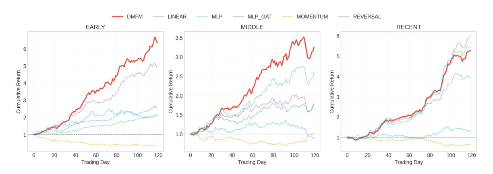

# Deep Multi-Factor Model on the KOSPI Market

**Team project** · Sahong Park, Minju Woo (Investment Theory and Optimization, HUFS)

A replication of the Deep Multi-Factor Model (DMFM; Wei, Dai & Lin, 2022), originally tested on Chinese equities, on Korean stocks listed on KOSPI. The goal was to see whether its industry- and market-neutralization structure still adds value in a different market.

📄 Full report (Korean): [DMFM_KOSPI_report_KR.pdf](DMFM_KOSPI_report_KR.pdf)

## Model

DMFM builds a "deep factor" for each stock in four steps:

1. **Stock context encoder**: an MLP turns 27 normalized style factors (21 technical, 6 fundamental / Fama-French style) into a latent context per stock.
2. **Industry neutralization**: a graph attention network over an industry graph (stocks in the same industry are connected) estimates the shared industry effect, which is subtracted from the context.
3. **Universe neutralization**: a second GAT over a fully connected graph estimates and removes the market-wide effect.
4. **Deep factor**: the original, industry-neutral and market-neutral contexts are concatenated and mapped to the final factor score.

The training objective rewards both explanatory power and stability of the factor over time.

## Setup

| | |
|---|---|
| Universe | 934 KOSPI stocks, 79 industries |
| Period | ≈3,000 trading days, 2013–2025; chronological 60/20/20 train/validation/test split |
| Horizons | 3, 5, 10, 15 and 20-day forward returns |
| Portfolio | Long top 10 / short bottom 10 by factor score, equal weight, rebalanced every 5 days |
| Costs | 0.1% commission, 0.2% slippage, 2% annual borrowing cost on shorts |
| Baselines | Linear (cross-sectional OLS), MLP, MLP + GAT (no neutralization), momentum, short-term reversal |

## Results (test period, net of costs)

| Model | IC | ICIR | Net Sharpe | Ann. return | MDD | Win rate |
|---|---:|---:|---:|---:|---:|---:|
| Linear | 0.041 | 16.14 | 1.36 | 23.1% | −26.3% | 56.4% |
| Momentum | −0.019 | −7.92 | −1.63 | −36.4% | −93.4% | 40.8% |
| Reversal | 0.019 | 7.92 | 0.05 | 1.1% | −61.0% | 48.3% |
| MLP | 0.049 | 8.34 | 1.80 | 33.0% | −28.5% | 61.7% |
| MLP + GAT | 0.049 | 15.20 | 2.18 | 41.5% | −32.5% | 62.5% |
| **DMFM** | 0.046 | **18.44** | **2.73** | **52.2%** | **−24.7%** | **66.7%** |

  

DMFM had a positive Sharpe ratio in all three sub-periods of the test set (early 3.31, middle 1.90, recent 2.99). MLP + GAT, which uses the same graphs without subtracting the estimated effects, was less consistent. In the report this is read as evidence that the **neutralization step**, not the graph itself, drives the improvement.

## Notes

- The test window (the last ~20% of 2013–2025) overlaps Korea's full short-selling ban (November 2023 – March 2025), so the short leg could not have been traded in practice during that time.
- ICIR here is computed as mean IC / std(IC) as defined in the report; the values are much higher than typical per-period ICIRs and depend on how the IC series is aggregated.

## Reference

Wei, Z., Dai, B., & Lin, D. (2022). Factor Investing with a Deep Multi-Factor Model. *arXiv:2210.12462*.
